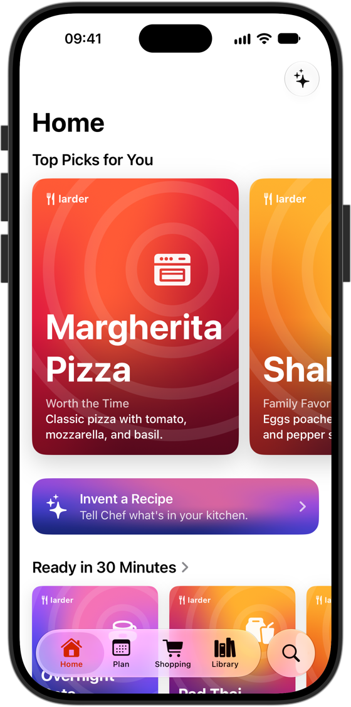
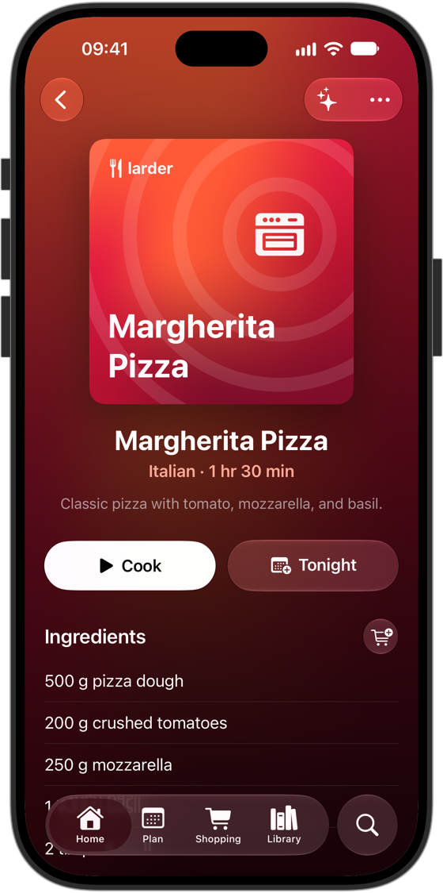
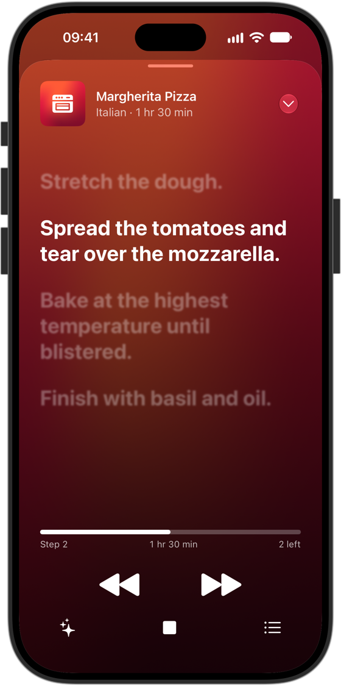
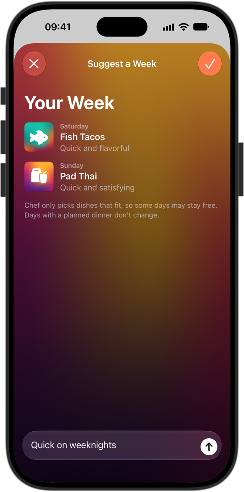
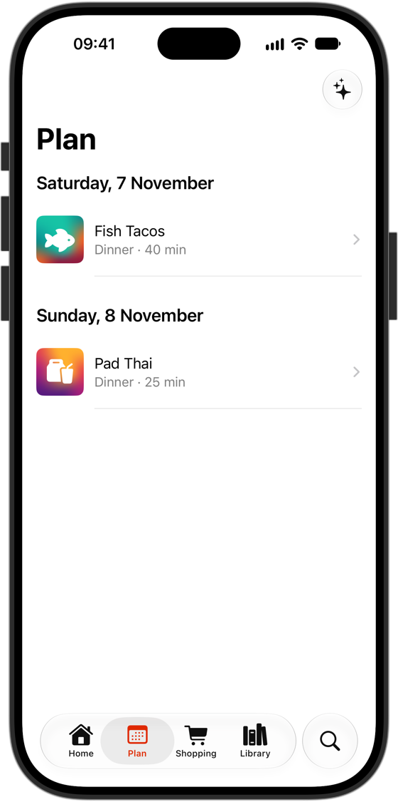
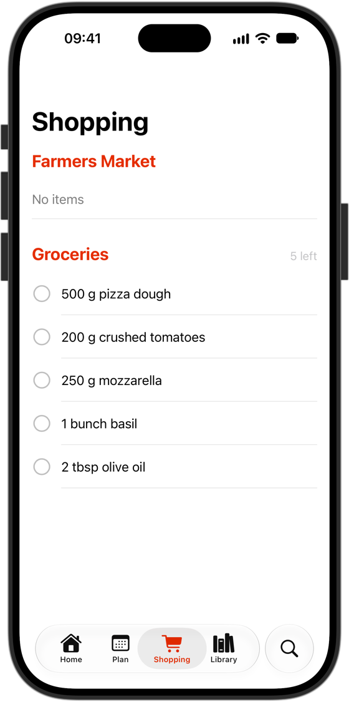
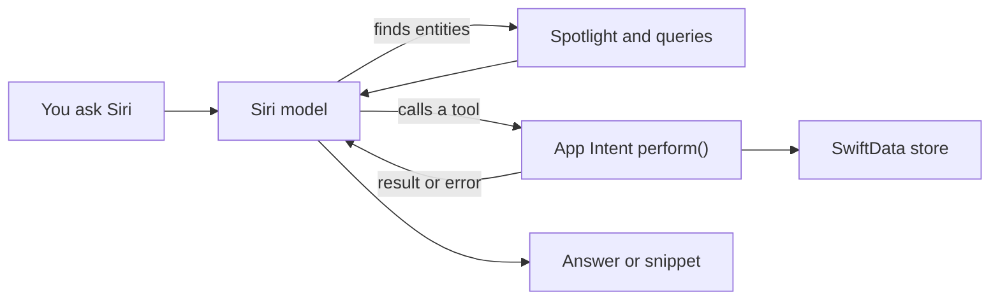

<div align="center">


# Larder

A recipe app that shows how to integrate with Siri AI and Foundation Models on iOS 27.


<sub>Chef invents a recipe on the device. Recorded in the iOS Simulator, sped up.</sub>

</div>

## How the app works

Larder keeps your recipes, a dinner plan, and shopping lists. You can use it by tapping, by asking Chef (the on-device model), or by asking Siri.

### Browse and cook

Pick a recipe, add its ingredients to your list, and start cooking. Cooking mode shows one step at a time.

<div align="center">
<table>
  <tr>
    <td></td>
    <td></td>
    <td></td>
  </tr>
</table>
</div>

### Plan the week and shop

Chef picks dinners from your recipes for the free days. Shopping lists collect what you need.

<div align="center">
<table>
  <tr>
    <td></td>
    <td></td>
    <td></td>
  </tr>
</table>
</div>

### Ask Siri

Run the app once so it can register its intents and index recipes, then try these on a supported device:

| You say | What it shows |
|---|---|
| In Larder, plan shakshuka for dinner on Friday | A tool with an entity parameter |
| What's planned for dinner tonight in Larder? | A read-only tool |
| Do I have a recipe with lentils? | Spotlight search |
| In Larder, save a recipe for Sunday Omelette. It takes 10 minutes, serves 2, and uses 3 eggs and 50 grams of cheese. | A value generated by the model |
| In Larder, plan my dinners for the week | An app skill |
| Add this to my shopping list (with a recipe open) | Onscreen context |
| In Larder, show me the margherita pizza | A snippet in Siri's response |
| Email the shakshuka recipe from Larder to Sam | Passing content to another app |

**Library → AI Examples** in the app links each mechanism to its source file and to a way of testing it.

## How Siri AI works

There's no separate SDK or entitlement. An app describes its actions and data with App Intents, and the Siri model picks a tool and fills in its parameters.



| Mechanism | API | Source |
|---|---|---|
| Tools | `@AppIntent(.tool)` | [MealPlanTools](Larder/Siri/Tools/MealPlanTools.swift), [ShoppingTools](Larder/Siri/Tools/ShoppingTools.swift), [RecipeTools](Larder/Siri/Tools/RecipeTools.swift) |
| Entities | `IndexedEntity`, `EnumerableEntityQuery`, `@Property(description:)` | [RecipeEntity](Larder/Siri/Entities/RecipeEntity.swift), [ShoppingListEntity](Larder/Siri/Entities/ShoppingListEntity.swift) |
| Generated values | `@AppEntity(.generable)` | [RecipeDraft](Larder/Siri/Entities/RecipeDraft.swift) |
| App skills | `Skills.skillsbundle/Skills/<name>/SKILL.md` | [Skills.skillsbundle](Larder/Skills.skillsbundle/Skills) |
| Onscreen context | `.userActivity`, `.appEntityIdentifier(_:)` | [RecipeDetailView](Larder/Views/RecipeDetailView.swift) |
| Snippets | `SnippetIntent`, `ShowsSnippetIntent` | [RecipeCardSnippet](Larder/Siri/Tools/RecipeCardSnippet.swift) |

Things that are easy to get wrong:

- **Don't write search tools.** Siri finds entities through Spotlight and queries, then passes them to your tool as parameters.
- **A tool can run at any time.** It can't depend on an open screen, and Siri may launch your process without UI.
- **Register dependencies in `App.init()`.** Reading an unregistered `@Dependency` is a `fatalError` you can't catch.
- **The model reads your errors.** Messages should say what to fix.
- **Validate generated values in `perform()`.** No query runs for them.
- **One bad `SKILL.md` disables all of the app's skills.** A skills bundle without a build phase also fails silently, so check for `Metadata.appintents/Skills.skillsc` in the built app.

### Preview limits

- Siri AI and `SiriEvaluations` need a physical device with Apple Intelligence.
- It's available on iOS, iPadOS, macOS, and visionOS 27.3. On iOS, iPadOS, and watchOS, it's not available in the EU.
- Supported languages are English, French, Japanese, Korean, Portuguese, and Spanish.
- It works in development builds and internal TestFlight only. The App Store opens in the spring, and the APIs may still change.

## Chef and Foundation Models

These features run on the device's model, with no network or API key.

| Feature | Where | API | Source |
|---|---|---|---|
| Recipe from ingredients or a photo | Home → ✨ | `streamResponse(generating:)`, `Attachment` | [RecipeInventor](Larder/AI/RecipeInventor.swift) |
| Dinners for the week | Plan → ✨ | `respond(to:generating:)` | [WeekPlanner](Larder/AI/WeekPlanner.swift) |
| Questions about a recipe | Recipe → ✨ | `LanguageModelSession`, `Tool` | [RecipeChat](Larder/AI/RecipeChat.swift), [ChefTools](Larder/AI/ChefTools.swift) |

The model isn't deterministic, so don't rely on it for allergies. The app reminds you of this in the chat.

## Build and run

You need Xcode 27.3.

```bash
open Larder.xcodeproj
```

To run on a device, set your team under Larder target → Signing & Capabilities. The project was created with `xcrun xcodeproj`, so use that command to change it. If you change the bundle ID, update it in both test targets too.

You can check the metadata and intents without a device:

```bash
xcrun sirimetadataanalyzer path/to/Larder.app
```

```bash
xcodebuild test -project Larder.xcodeproj -scheme LarderIntentTests -destination 'platform=iOS Simulator,name=iPhone 18 Pro'
```

On a device, run the `LarderSiriEvaluations` scheme (⌘U) and keep the device unlocked. Siri's answers vary, so run the suite several times.

## What's been tested

| Area | Status |
|---|---|
| Metadata analyzer | No findings: 13 intents, 10 tools, 6 entities |
| Intent tests in the Simulator | 16 of 16 pass |
| Chef features in the Simulator | Work, but the first request can fail, so try again |
| Reading ingredients from a photo | Not tested |
| Anything that needs real Siri: tool choice, skills, authentication, snippets, passing content to other apps | **Not tested** |
| `LarderSiriEvaluations` | Compiles, but hasn't been run |

## Sources

- [Siri AI Developer Preview](https://developer.apple.com/documentation/appintents/siri-ai-developer-preview)
- [Bringing custom actions and content to Siri](https://developer.apple.com/documentation/appintents/bringing-custom-actions-and-content-to-siri)
- [Orchestrating complex actions with app skills](https://developer.apple.com/documentation/appintents/orchestrating-complex-actions-with-app-skills)
- [Siri Evaluations](https://developer.apple.com/documentation/sirievaluations)
- [Foundation Models](https://developer.apple.com/documentation/foundationmodels)
- Xcode 27.3 guides: `Xcode.app/Contents/PlugIns/IDEIntelligenceChat.framework/Versions/A/Resources/siri-*`
